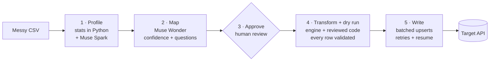

# Porter

**An agent that migrates messy data into any API, safely.**

Porter reads a messy export, works out what each column means, and proposes how to fill each field of the target API, with a confidence score on every field. It writes nothing until a human has approved the mapping and a full dry run has passed. Writes are batched, retried and idempotent, so a migration that dies halfway resumes without creating duplicates.

Built solo for the [Meta Global AI Developer Hackathon 2026](https://cerebralvalley.ai/e/meta-ai-developer-hackathon) (Indie track, *Build for Your World*) with Meta's Muse models.

> 🎥 **Demo (3 min):** TODO · 📊 **Benchmark:** 99.85 % of cells correct after transform, 0 rows rejected, $0.70 per migration ([results.md](results.md))

## Why this matters

I run data migrations for enterprise customers of a SaaS platform, and every one follows the same pattern. Someone hands over an export from a legacy system: a spreadsheet, a CSV dump. Before a single record moves, someone spends days working out which column is which, what "Cond." or "Boro" means, which of three date formats each row uses, and why a few percent of rows fail on import.

A chatbot can guess a mapping faster than a person, but that creates new problems. It doesn't tell you which fields it is unsure about. It rewrites rows in ways you can't audit. And nothing stops a half-finished import from writing duplicates when you run it again.

Porter uses the model where it is genuinely good: reading a column and understanding what it is. Everything that touches the actual data happens in deterministic code that a person can review.

## How it works



1. **Profile.** Python computes statistics for each column: inferred type, nulls, distinct values, value shapes, and up to 20 sample values. **Muse Spark** turns them into a semantic profile covering what the column means, its formats and units, and every spelling of each category (`Good`, `good`, `G`).
2. **Map.** **Muse Wonder** reads the profile and the target's schema, taken from its OpenAPI spec, and proposes how to fill each target field. Options include copying, mapping values, converting units, parsing dates and splitting a combined field. Each proposal comes with a confidence score and the evidence behind it. When the data can't settle a business question, such as *should stumps get their stump diameter?*, it asks instead of guessing.
3. **Approve.** Fields below 0.85 confidence, and every open question, go to review. Nothing moves until a human approves.
4. **Transform and dry run.** A deterministic engine applies the approved mapping. For the few fields it can't express, the model writes one small pure Python function, once; you review it, and an AST check limits what it can import and touch. All of this runs over every row without calling the model again, and each result is validated against the target schema. Every failing row is listed with the reason.
5. **Write.** Porter sends batched upserts keyed on the target's primary key, with retries and exponential backoff on 429 and 5xx errors. A checkpoint records the last committed batch, so a run that is killed resumes where it stopped, and running it again never creates duplicates.

## Where the Meta models do the work

| Step | Model | What the model decides |
| --- | --- | --- |
| Profile | Muse Spark | Meaning, formats, units and category variants of every column |
| Map | Muse Wonder | Which column fills which field, how to transform it, how confident it is, and what to ask |
| Transform code | Muse Wonder | A small Python function for each field the deterministic engine can't express |

The model sees statistics and a few sample values per column, plus the distinct values of any column it writes code for. It never sees the full dataset and never transforms rows itself. That makes a migration cheap, repeatable and auditable: the same approved mapping always produces the same output.

Model output is checked twice before Porter trusts it: once against a JSON Schema (`schemas/`), and once by semantic checks (`porter/checks.py`). The semantic checks catch invented column names, value maps that miss a variant, values outside the target's allowed set, and target fields left out. If a check fails, the errors go back to the model for one retry.

## Benchmark

The demo uses a 5,000-row sample of the [2015 NYC Street Tree Census](https://catalog.data.gov/dataset/2015-street-tree-census-tree-data) from NYC Open Data. A seeded generator turns it into a realistic legacy export with:

- renamed columns
- three date formats
- condition written as `Good`, `good` or `G`
- diameters written as `12 in`
- coordinates combined into one field
- repeated rows and distractor columns

The generator records the correct mapping, so accuracy is measured, not eyeballed.

| Metric | Result |
| --- | --- |
| Target fields mapped correctly | 7.7 / 9 (8.7 / 9 counting copy and cast as equal) |
| Cell values matching ground truth after transform | 99.85 % |
| Rows rejected by the dry run, each with a reason | 0 |
| Model cost per migration | 0.70 USD |

Results are averaged over 3 seeded variants of the file (seeds 7–9, 5,000 rows each), with Muse Spark 1.3 and Muse Wonder 1.0. The benchmark accepts the model's recommended answer to every question, so a wrong recommendation counts against it. The misses, per seed, are in [results.md](results.md):

- `external_id` was mapped as a plain copy instead of a cast every time. Both produce the same text.
- On one seed the model asked what diameter stumps should get, but recommended the wrong option, so 141 stump rows got 0. A person reviewing the question in the UI would catch this.
- 51 `species` cells keep the wrong casing. These are rare species that appear once or twice, so there is no majority spelling to restore.

## Safety by design

- **Human approval gate:** low-confidence fields and open questions block the write.
- **No model on the data path:** the engine is deterministic, and generated functions are written once, reviewed, checked and then run without the model.
- **Dry run first:** every row is validated against the target schema before any write.
- **Idempotent writes:** upserts keyed on the primary key make re-runs safe.
- **Resumable:** checkpoints let a killed run continue from the last committed batch.
- **Untrusted input:** the prompts treat cell values as data, never as instructions.

## Quickstart

```bash
git clone https://github.com/cristobalcastrillon/porter.git && cd porter
python -m venv .venv && source .venv/bin/activate
pip install -r requirements.txt
cp .env.example .env   # MODEL_API_KEY, META_BASE_URL, PORTER_PROFILE_MODEL, PORTER_MAPPING_MODEL, SUPABASE_URL, SUPABASE_SECRET_KEY
python -m porter.make_dirty --rows 5000 --seed 7
python -m porter.smoke # one cheap call, to check the key
streamlit run app.py
```

The target table is in `sql/001_assets.sql`. The UI walks the steps and shows the write command to run in a terminal:

```bash
python -m porter.write --run <run_id>
PORTER_FAULTS=429:0.15 python -m porter.write --run <run_id> --pace 0.5   # simulated 429s, slow enough to watch
python -m porter.evaluate --seeds 3                                       # writes results.md
```

Kill the writer at any point and run the same command to resume. To try everything with no API key, use `PORTER_FAKE_LLM=1 streamlit run app.py` and `pytest`.

## Built during the hackathon

Everything in this repository was written during the hackathon (Oct 26 – Nov 4, 2026). No code from earlier projects or from any employer is reused. The commit history shows the full build, starting with `b2d99ea` (Nov 1).

## Limitations and next steps

- CSV input and a single target table for now. Excel, scanned paper forms read by a multimodal Muse model, and multi-table migrations with foreign-key ordering are next.
- A per-run rollback log, so a migration can be undone as well as resumed.

## License

MIT. Demo data comes from NYC Open Data and is used under its [terms of use](https://www.nyc.gov/html/data/terms.html).
